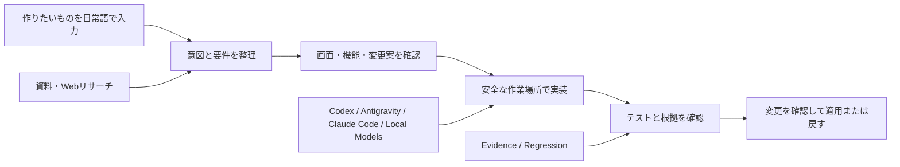
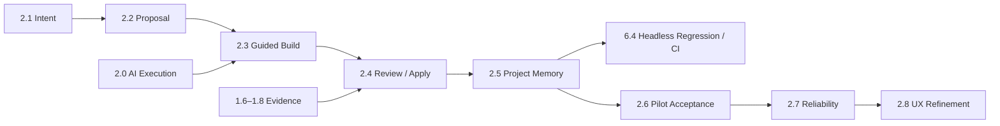

# Onigiri Harness 開発計画

更新日: 2026-10-13

## 製品の方向性

Onigiri Harnessは、コーディング・エージェントを操作するためのアプリではありません。作りたいものを日常語で伝えると、要件を一緒に整理し、提案を確認し、安全な作業場所で実装・検証し、分かりやすい変更内容として受け取れる **ローカルファーストのVibe Build環境** です。

Codex、Antigravity、Claude Code、ローカルLLMは、この体験を実現するための実行手段です。利用者がCLI、モデル名、Gitの細部を常に理解している必要はありません。資料、Webリサーチ、回答根拠、回帰試験は、作るものと変更内容を信頼して判断するための共通基盤として扱います。

## フェーズ表記

- **Parent Phase**: 製品としての大きな到達点
- **Sub-phase**: Parent Phaseを完成させる実装単位
- 表記例: `Parent Phase 2 / Sub-phase 2.2 — Build Proposal`

以前の番号は実装履歴としてのみ参照します。今後の作業依頼と完了報告は、以下の計画のParent Phase / Sub-phaseを使用します。

## 全体像と現在地

| Parent Phase | 状態 | 到達点 |
| --- | --- | --- |
| **0 — Local AI Foundation** | 実装済み | 会話、Profile、複数モデル、保存、停止、コンテキスト構築 |
| **1 — Grounded Knowledge & Evidence** | 実装済み | 共通RAG、資料管理、引用、評価、根拠記録、再現・回帰確認 |
| **2 — Vibe Build Workspace** | 進行中 | 自然言語の企画から、提案、実装、確認可能な適用までを一貫化 |
| **3 — Decision Lab** | 実装済み | Jev類似モデルの実験、比較、評価、ルーティング検討 |
| **4 — Local AI Gateway** | 実装済み | OpenAI互換APIとCLIベースの通常チャット |
| **5 — Trust, Web & Distribution** | 大部分実装済み | 安全性、移行、Webリサーチ、アクセシビリティ、公開・CI |
| **6 — Continuous Quality** | 実装済み | Evidence Regression、headless RAG評価、基準比較、CIゲートを実装済み |

次に実装する候補は、利用時に判明したVibe Buildまたは評価基盤の改善点を、独立したSub-phaseとして定義して着手します。

## Parent Phase 0 — Local AI Foundation

状態: **実装済み**

ローカルmacOSアプリとして、モデルを交換しても同じ会話体験を維持する土台です。

| Sub-phase | 状態 | 内容 |
| --- | --- | --- |
| 0.1 — Skeleton | 実装済み | SwiftUI、HTTP、Harness Server、Harness Core、Apple Foundation Modelsの最小往復 |
| 0.2 — Chat Base | 実装済み | 複数ターン、Streaming、会話履歴、エラー表示、書き出し |
| 0.3 — Model Providers | 実装済み | Apple FM、LM Studio、Ollama、OpenAI互換ローカルモデルの共通Provider |
| 0.4 — Product Profiles | 実装済み | モデル、指示、RAG、検索、コンテキスト設定をProfileとして保存・切替 |
| 0.5 — Chat Runtime & Context Builder | 実装済み | 会話・指示・資料を一貫して組み立て、停止・圧縮・上限を管理 |

## Parent Phase 1 — Grounded Knowledge & Evidence

状態: **実装済み**

特定モデルに依存しない知識基盤です。資料がない時には資料があるように振る舞わず、利用した資料と検索判断を確認できることを基本契約にします。

| Sub-phase | 状態 | 内容 |
| --- | --- | --- |
| 1.1 — Knowledge Ingestion | 実装済み | TXT、Markdown、PDF、フォルダ取込、分割、永続化、資料プレビュー |
| 1.2 — Search & Citations | 実装済み | Keyword・日本語n-gram・Embedding検索、Top K、引用、検索設定 |
| 1.3 — RAG Modes & Manager | 実装済み | `disabled`、`always`、モデル共通のRAG ManagerとTool契約 |
| 1.4 — Agentic RAG | 実装済み | 検索要否、検索語、再検索を判断し、追跡可能な形で実行 |
| 1.5 — RAG Evaluation & Diagnostics | 実装済み | 検索判断・資料カバレッジ・回帰・原因候補を評価 |
| 1.6 — Evidence Flight Recorder | 実装済み | 回答時のProfile、モデル、履歴、RAG、引用、遅延を保存 |
| 1.7 — Counterfactual Replay | 実装済み | 同じ条件を別Profile・RAG設定で独立再実行して比較 |
| 1.8 — Regression Suites & Reports | 実装済み | 基準ケース、ポリシー、合格・要確認・失敗、Markdown/CSVレポート |

## Parent Phase 2 — Vibe Build Workspace

状態: **実運用検証へ移行**

「AIにコーディングを依頼する」画面を、「作りたい体験を対話で形にする」ワークスペースへ発展させます。実装中の変更は利用者の作業フォルダへ直ちに適用せず、提案と検証結果を確認できる段階を必ず挟みます。

既存のAIタスク、Codex / Antigravity / Claude Code Adapter、通常チャット連携は、このParent Phaseを開始するための**実装済みの基盤**です。

| Sub-phase | 状態 | 内容 |
| --- | --- | --- |
| 2.0 — Agent Execution Foundation | 実装済み | 複数AIのタスク実行、進行表示、取消、タイムアウト、履歴、MCPによるRAG参照 |
| 2.1 — Project Brief & Intent Canvas | 実装済み | 「何を作りたいか」を目的、対象者、必須機能、制約、完成条件、次の一手へ整理し、プロジェクトとしてローカル保存 |
| 2.2 — Build Proposal | 実装済み | Briefから画面・機能、完成確認、変更範囲、制約、未確認事項を生成し、下書き・要確認・確認済みとして保存 |
| 2.3 — Guided Build Orchestration | 実装済み | 確認済みの提案から、Git worktreeまたは安全なコピーを作成し、隔離環境だけに書込み可能なAIタスクを開始・記録 |
| 2.4 — Review, Apply & Revert | 実装済み | AIタスク結果、変更ファイル、パッチを確認し、明示確認の後にGit作業フォルダへ適用・適用取り消し・隔離環境破棄を行う |
| 2.5 — Project Memory & Iteration | 実装済み | 決定事項、未解決事項、提案・隔離ビルド・適用判断の履歴をプロジェクト単位で保存し、次の一手へ引き継ぐ |
| 2.6 — Vibe Build Pilot Acceptance | 実施済み・2.7へ移行 | 代表プロジェクトを隔離Git worktreeとAIタスクで検証し、保存処理とタスク完了待機の改善事項を記録 |
| 2.7 — Build Reliability & Recovery | 実装済み | 作業元の事前診断、隔離worktreeの不要情報掃除、タスク状態の自動同期、同じ隔離環境での再試行を追加 |
| 2.8 — Vibe Build UX Refinement | 実装済み | 3段階のガイド、作業元の開始前確認、提案・レビューの平易な案内を追加 |
| 2.9 — Vibe Build Pilot Re-Acceptance | 実施済み | クリーンなGitプロジェクトで隔離worktree、変更確認、適用、取消と元のクリーン状態への復帰を確認 |
| 2.10 — Vibe Build Validation Profiles | 実装済み | プロジェクトごとの完成確認項目を保存し、AIビルド依頼に同梱 |
| 2.11 — Validation Results & Evidence | 実装済み | AIと手動の確認結果をプロジェクト単位で保存・確認 |
| 2.12 — Completion Readiness | 実装済み | 目標、計画、確認項目、確認結果を基に完成の準備状況を判断 |
| 2.13 — Project Handoff & Shareable Summary | 実装済み | 目標、計画、ビルド履歴、確認結果、未解決事項をMarkdownとして書き出す |
| 2.15 — Template Library & Custom Templates | 実装済み | 標準テンプレートと個人用テンプレートの保存・再利用・削除 |
| 2.16 — Project Archive & Portfolio | 実装済み | 完成済みプロジェクトのアーカイブ、復元、一覧での振り返り |
| 2.17 — Portfolio Insights | 実装済み | アーカイブ済みプロジェクトの完成数、確認結果、要対応事項を横断集計 |
| 2.18 — Portfolio Search & Filters | 実装済み | アーカイブ済みプロジェクトをキーワードと確認状態で検索・絞り込み |
| 2.19 — Portfolio Export & Review Report | 実装済み | アーカイブ済みプロジェクトをMarkdown/CSVで書き出し |
| 2.20 — Project Restore & Reopen Flow | 実装済み | アーカイブしたプロジェクトを次の一手とともに作業中へ復元 |
| 2.21 — Project Timeline & Milestones | 実装済み | 計画、ビルド、確認、完成、保管、再開の出来事を時系列表示 |
| 2.22 — Milestone Notes & Decisions | 実装済み | 判断理由や次回への注意点を節目メモとして時系列へ保存 |
| 2.23 — Project Health Dashboard | 実装済み | 目標・計画・検証・未解決事項から次に進める作業を表示 |
| 2.24 — Project Risk & Blocker Management | 実装済み | タスク・リスク・ブロッカーを優先度と解決状態つきで管理し、次の作業へ反映 |
| 2.25 — Project Dependencies & Sequencing | 実装済み | 課題間の依存関係を設定し、着手可能な順序と依存関係待ちを可視化 |
| 2.26 — Project Ownership & Due Dates | 実装済み | 課題の担当者と期限を管理し、期限超過と直近の対応事項を状態表示 |
| 2.27 — Project Notifications & Daily Focus | 実装済み | 作業中プロジェクトを横断し、期限超過・ブロッカー・直近の課題を今日の優先事項として表示 |
| 2.28 — Project Activity Feed & Weekly Review | 実装済み | 判断・課題・ビルド・確認の履歴を横断集約し、過去7日間の活動を週次レビューとして表示 |
| 2.29 — Project Review Actions | 実装済み | 優先課題から担当者・期限・次の一手を更新し、課題をレビュー画面から解決可能 |
| 2.30 — Project Status Reports | 実装済み | 進捗、ブロッカー、期限、次の一手を全プロジェクト横断のMarkdownレポートとして書き出し |
| 2.31 — Project Status Report History | 実装済み | 書き出した状況レポートの要点を保存し、前回との差分を未解決事項・ブロッカー・期限超過で比較 |
| 2.32 — Project Report Scheduling | 実装済み | 日次・週次の自動作成を設定し、プロジェクト画面を開いた際にMarkdownレポートを保存 |
| 2.33 — Project Report Destinations & Sharing | 実装済み | 保存先を選択しFinderで開き、MarkdownまたはCSV形式で状況レポートを共有可能 |
| 2.34 — Project Report Templates | 実装済み | 日次確認・週次レビュー・共有用サマリーから用途別にレポート内容を選択 |
| 2.35 — Explicit Project Memory | 実装済み | プロジェクト固有の指示・前提・除外情報を明示保存し、AIビルドタスクへ安全に適用 |
| 2.36 — Project-Scoped Chat Context | 実装済み | 会話ごとにプロジェクトを選択し、目標と明示メモリーを安全にチャットへ適用 |
| 2.37 — Project Coordinator | 実装済み | 依存関係を満たした課題を順番に選び、隔離AIビルドへ安全に委任 |
| 2.38 — Coordinator Task Runs & Review Queue | 実装済み | 委任した課題とAIビルドを関連付け、実行中・確認待ち・完了をレビューキューで追跡 |

完了条件:

- 「読書記録アプリを作りたい」のような依頼から、確認可能なBriefを作成できる
- 実装前に、何が作られ何が変わるかを技術用語に偏らず確認できる
- 実装・テストは安全な作業コピーで実行される
- 変更を元の作業場所へ反映する前に、要約・テスト結果・差分を確認できる
- 次の会話で、過去の決定と未完了事項を自然に引き継げる

### Sub-phase 2.6 — Vibe Build Pilot Acceptance

状態: **実施済み・改善事項あり**

実装を増やす前に、実際の小さなプロジェクトを一つ完成まで通します。推奨ケースは「既存macOSアプリに、保存される簡単な一覧画面を追加する」程度の、変更範囲と完成条件が明確なものです。

確認する流れ:

1. 目的・対象者・完成条件をBriefへ入力する
2. 提案を確認し、未解決事項を決めて「確認済み」にする
3. Gitリポジトリを作業元として隔離ビルドを開始する
4. AIタスク結果、変更ファイル、パッチ、テスト結果を確認する
5. 元フォルダへ適用し、元フォルダからビルド・起動・完成条件を確認する
6. プロジェクトの記憶へ、よかった点・迷った点・失敗・次の改善を記録する

受入条件:

- 隔離Git worktreeの作成と、元フォルダが未変更であることを実済み
- 保存初期化のmacOS上の不具合を修正し、サーバー起動とAIタスク開始を実済み
- AIタスクが600秒でタイムアウトしたため、差分確認・適用・取消の終端通過は2.7で再検証する
- 再現手順・期待結果・実際の結果は `docs/VIBE_BUILD_PILOT_2026-10-14.md` に記録

### Sub-phase 2.7 — Build Reliability & Recovery

状態: **実装済み**

- 隔離ビルドの開始前に、作業元フォルダの存在、書込権限、Gitの未コミット変更を確認する
- Gitの未コミット変更がある場合は、元フォルダへの影響を避けるため開始を止め、次の対処を示す
- 隔離worktreeを作る前に、Gitの既に使われていないworktree情報を整理する
- 実行中のAIタスクは、進行・完了・失敗・タイムアウトをビルド履歴に自動反映する
- 失敗、キャンセル、タイムアウトのタスクは、同じ隔離環境で再試行できる。以前の結果は履歴に残る
- 隔環境の破棄・適用・取消は、これまでどおり確認操作として残す

### Sub-phase 2.8 — Vibe Build UX Refinement

状態: **実装済み**

- 「作りたい結果を書く」「計画を確認する」「安全な場所で作る」の3段階を、運び方ガイドとして確認できる
- 完了した段階はチェック表示とし、次に進むべき場所を明確にする
- 作業元は開始前に確認でき、Gitの未コミット変更や非Gitフォルダの扱いを画面上で説明する
- 提案は「AIが作るもののプレビュー」、レビューは「確認してから反映・取消・破棄を選ぶ」流れとして案内する

## Parent Phase 3 — Decision Lab

状態: **実装済み**

Jevに限らず、ローカルまたは互換APIで提供される意思決定モデルを、通常会話と分離して比較・評価します。判断結果は観察・提案に留め、外部操作を自動実行しません。

| Sub-phase | 状態 | 内容 |
| --- | --- | --- |
| 3.1 — Decision Model Lab | 実装済み | Jev、Ollaya、TypeSafe互換Provider、状態・質問の正規化、履歴 |
| 3.2 — Decision Evaluation & Routing Policies | 実装済み | 精度、calibration、遅延、confidence、fallbackの評価 |
| 3.3 — Decision Comparison & Presets | 実装済み | 入力プリセットと複数モデルの同条件比較 |

## Parent Phase 4 — Local AI Gateway

状態: **実装済み**

| Sub-phase | 状態 | 内容 |
| --- | --- | --- |
| 4.1 — Compatibility API | 実装済み | `/v1/models`、`/v1/chat/completions`、Streaming、Profile指定、RAG拡張情報 |
| 4.2 — AI CLI Chat Providers | 実装済み | Codex、Antigravity、Claude Codeを通常チャットのモデルとして利用 |

## Parent Phase 5 — Trust, Web & Distribution

状態: **大部分実装済み**

ローカルで安全に使い、情報取得の範囲を自分で制御し、GitHubから再現可能な形で受け取れる状態を整えます。

| Sub-phase | 状態 | 内容 |
| --- | --- | --- |
| 5.1 — Security, Reliability & Migration | 実装済み | loopback保護、Keychain、バックアップ・復元、移行、AIタスクの書込み境界 |
| 5.1a — Release-blocking Fixes | 実装済み | Apple FM、RAG引用、再検索、CLIタスクの受入上の不具合修正 |
| 5.1b — Final Manual Acceptance | 実装済み | 基本操作、会話復元、停止、書出し、表示崩れを手動受入で確認 |
| 5.2a — Repository Readiness | 実装済み | Apache-2.0、README、貢献・セキュリティ文書、GitHub基盤 |
| 5.2b — Reproducible Build & CI | 実装済み | 再現可能なビルド、成果物検査、GitHub Actions、秘密情報検査 |
| 5.2c — Signed macOS Distribution | 任意・保留 | Apple Developer Program加入時の署名・公証・Staple自動化 |
| 5.2d — GitHub Source Publication | 実装済み | 公開ソース、クリーンclone、ローカルビルド導線 |
| 5.2e — Public Launch Verification | 実装済み | 初回会話、資料なし時の挙動、IME Enter、言語切替を確認・修正 |
| 5.2f–5.2s — Web Research | 実装済み | 内包ブラウザ、SearXNG/Tavily、診断、自動利用、設定、プライバシー、アクセシビリティ、検索プリセット、別ウインドウ |

今後必要になった場合は、Webリサーチの同期・共有、Provider追加、公開配布を、独立したSub-phaseとして追加します。

## Parent Phase 6 — Continuous Quality

状態: **実装済み**

回答品質を「感覚」だけで判断せず、根拠・再現・比較によって継続的に確認する層です。

| Sub-phase | 状態 | 内容 |
| --- | --- | --- |
| 6.1 — Evidence & Replay Lab | 実装済み | Context Flight RecorderとCounterfactual Replay |
| 6.2 — Evidence Regression Suites | 実装済み | 重要な回答の基準ケースと条件比較 |
| 6.3 — Regression Policies & Reports | 実装済み | 回帰分類、ポリシー、Markdown/CSVレポート |
| 6.4 — Headless Regression & CI Gate | 実装済み | `onigiri-eval`でGUIなしに評価を実行し、基準レポートとの回帰比較を終了コードへ反映。self-hosted macOS Runner用の手動CIゲートを追加 |

## 実装の優先順

次は **Parent Phase 2 / Sub-phase 2.9 — Vibe Build Pilot Re-Acceptance** を提案します。改善したガイドと回復経路を使い、小さなプロジェクトで実装、レビュー、適用、取消までを通して受入確認します。

## 旧計画との対応

既に完了した機能を失ったり、移し替えたりするものではありません。番号を将来の製品体験に合わせて整理し直すための対応表です。

| これまでの表記 | 新しい位置 |
| --- | --- |
| Parent Phase 0 / Sub-phase 0.1–0.5 | Parent Phase 0 / Sub-phase 0.1–0.5 |
| Parent Phase 1 / Sub-phase 1.1–1.5 | Parent Phase 1 / Sub-phase 1.1–1.5 |
| 旧 Parent Phase 2 / Sub-phase 2.1–2.3 | Parent Phase 2 / Sub-phase 2.0（Agent Execution Foundation） |
| Parent Phase 3 / Sub-phase 3.1–3.3 | Parent Phase 3 / Sub-phase 3.1–3.3 |
| Parent Phase 4 / Sub-phase 4.1–4.2 | Parent Phase 4 / Sub-phase 4.1–4.2 |
| Parent Phase 5 / Sub-phase 5.1–5.2s | Parent Phase 5 / 各該当Sub-phase |
| 旧 Parent Phase 6 / Sub-phase 6.1–6.3 | Parent Phase 1 / Sub-phase 1.6–1.8、および Parent Phase 6 / Sub-phase 6.1–6.3として継続参照 |

Evidence機能は、知識の根拠層でもあり、継続品質の検証層でもあります。このため実装済み番号の互換性を保ったまま、製品構成上はParent Phase 1と6の両方から参照します。

## 設計原則

- まず利用者の意図と完成条件を確認し、モデル・CLI・Gitの選択は内部の手段として扱う
- 資料、Web、会話、実装結果の出所を確認可能にする
- AIが変更を提案・実装しても、元の作業場所への適用は利用者が確認して決める
- 実装・検証は安全な作業コピーで行い、取消・再試行・履歴確認を可能にする
- RAG、Evidence、評価は特定のモデルやAIコーディングCLIへ閉じない
- 保存形式にはバージョンと移行を用意し、既存の会話、資料、評価データを守る
- 新しいSub-phaseは完了条件と回帰確認を備え、既存の操作を壊さない
