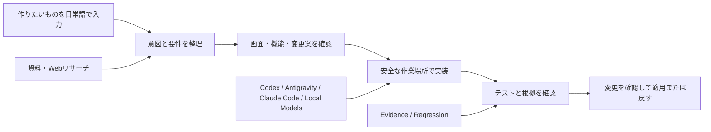
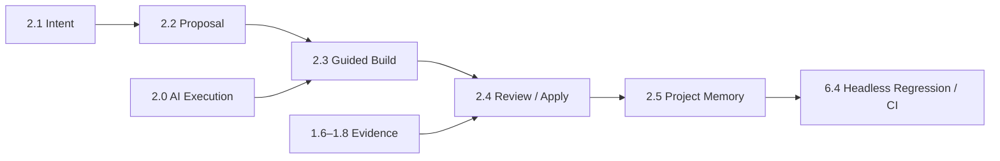

# Onigiri Harness 開発計画

更新日: 2026-10-13

## 製品の方向性

Onigiri Harnessは、コーディング・エージェントを操作するためのアプリではありません。作りたいものを日常語で伝えると、要件を一緒に整理し、提案を確認し、安全な作業場所で実装・検証し、分かりやすい変更内容として受け取れる **ローカルファーストのVibe Build環境** です。

Codex、Antigravity、Claude Code、ローカルLLMは、この体験を実現するための実行手段です。利用者がCLI、モデル名、Gitの細部を常に理解している必要はありません。資料、Webリサーチ、回答根拠、回帰試験は、作るものと変更内容を信頼して判断するための共通基盤として扱います。

## フェーズ表記

- **Parent Phase**: 製品としての大きな到達点
- **Sub-phase**: Parent Phaseを完成させる実装単位
- 表記例: `Parent Phase 2 / Sub-phase 2.2 — Build Proposal`

以前の番号は実装履歴としてのみ参照します。今後の作業依頼と完了報告は、以下の計画のParent Phase / Sub-phaseを使用します。

## 全体像と現在地

| Parent Phase | 状態 | 到達点 |
| --- | --- | --- |
| **0 — Local AI Foundation** | 実装済み | 会話、Profile、複数モデル、保存、停止、コンテキスト構築 |
| **1 — Grounded Knowledge & Evidence** | 実装済み | 共通RAG、資料管理、引用、評価、根拠記録、再現・回帰確認 |
| **2 — Vibe Build Workspace** | 進行中 | 自然言語の企画から、提案、実装、確認可能な適用までを一貫化 |
| **3 — Decision Lab** | 実装済み | Jev類似モデルの実験、比較、評価、ルーティング検討 |
| **4 — Local AI Gateway** | 実装済み | OpenAI互換APIとCLIベースの通常チャット |
| **5 — Trust, Web & Distribution** | 大部分実装済み | 安全性、移行、Webリサーチ、アクセシビリティ、公開・CI |
| **6 — Continuous Quality** | 一部実装済み | Evidence Regressionは実装済み。Headless実行とCI判定が次の候補 |

次に実装する候補は、**Parent Phase 2 / Sub-phase 2.5 — Project Memory & Iteration** です。目標、提案、実装、確認の判断を時系列で残し、次の改善依頼へ自然につなげられるようにします。

## Parent Phase 0 — Local AI Foundation

状態: **実装済み**

ローカルmacOSアプリとして、モデルを交換しても同じ会話体験を維持する土台です。

| Sub-phase | 状態 | 内容 |
| --- | --- | --- |
| 0.1 — Skeleton | 実装済み | SwiftUI、HTTP、Harness Server、Harness Core、Apple Foundation Modelsの最小往復 |
| 0.2 — Chat Base | 実装済み | 複数ターン、Streaming、会話履歴、エラー表示、書き出し |
| 0.3 — Model Providers | 実装済み | Apple FM、LM Studio、Ollama、OpenAI互換ローカルモデルの共通Provider |
| 0.4 — Product Profiles | 実装済み | モデル、指示、RAG、検索、コンテキスト設定をProfileとして保存・切替 |
| 0.5 — Chat Runtime & Context Builder | 実装済み | 会話・指示・資料を一貫して組み立て、停止・圧縮・上限を管理 |

## Parent Phase 1 — Grounded Knowledge & Evidence

状態: **実装済み**

特定モデルに依存しない知識基盤です。資料がない時には資料があるように振る舞わず、利用した資料と検索判断を確認できることを基本契約にします。

| Sub-phase | 状態 | 内容 |
| --- | --- | --- |
| 1.1 — Knowledge Ingestion | 実装済み | TXT、Markdown、PDF、フォルダ取込、分割、永続化、資料プレビュー |
| 1.2 — Search & Citations | 実装済み | Keyword・日本語n-gram・Embedding検索、Top K、引用、検索設定 |
| 1.3 — RAG Modes & Manager | 実装済み | `disabled`、`always`、モデル共通のRAG ManagerとTool契約 |
| 1.4 — Agentic RAG | 実装済み | 検索要否、検索語、再検索を判断し、追跡可能な形で実行 |
| 1.5 — RAG Evaluation & Diagnostics | 実装済み | 検索判断・資料カバレッジ・回帰・原因候補を評価 |
| 1.6 — Evidence Flight Recorder | 実装済み | 回答時のProfile、モデル、履歴、RAG、引用、遅延を保存 |
| 1.7 — Counterfactual Replay | 実装済み | 同じ条件を別Profile・RAG設定で独立再実行して比較 |
| 1.8 — Regression Suites & Reports | 実装済み | 基準ケース、ポリシー、合格・要確認・失敗、Markdown/CSVレポート |

## Parent Phase 2 — Vibe Build Workspace

状態: **次に着手**

「AIにコーディングを依頼する」画面を、「作りたい体験を対話で形にする」ワークスペースへ発展させます。実装中の変更は利用者の作業フォルダへ直ちに適用せず、提案と検証結果を確認できる段階を必ず挟みます。

既存のAIタスク、Codex / Antigravity / Claude Code Adapter、通常チャット連携は、このParent Phaseを開始するための**実装済みの基盤**です。

| Sub-phase | 状態 | 内容 |
| --- | --- | --- |
| 2.0 — Agent Execution Foundation | 実装済み | 複数AIのタスク実行、進行表示、取消、タイムアウト、履歴、MCPによるRAG参照 |
| 2.1 — Project Brief & Intent Canvas | 実装済み | 「何を作りたいか」を目的、対象者、必須機能、制約、完成条件、次の一手へ整理し、プロジェクトとしてローカル保存 |
| 2.2 — Build Proposal | 実装済み | Briefから画面・機能、完成確認、変更範囲、制約、未確認事項を生成し、下書き・要確認・確認済みとして保存 |
| 2.3 — Guided Build Orchestration | 実装済み | 確認済みの提案から、Git worktreeまたは安全なコピーを作成し、隔離環境だけに書込み可能なAIタスクを開始・記録 |
| 2.4 — Review, Apply & Revert | 実装済み | AIタスク結果、変更ファイル、パッチを確認し、明示確認の後にGit作業フォルダへ適用・適用取り消し・隔離環境破棄を行う |
| 2.5 — Project Memory & Iteration | 計画済み | 決定事項、未解決事項、変更履歴、次の改善候補をプロジェクト単位で引き継ぐ |

完了条件:

- 「読書記録アプリを作りたい」のような依頼から、確認可能なBriefを作成できる
- 実装前に、何が作られ何が変わるかを技術用語に偏らず確認できる
- 実装・テストは安全な作業コピーで実行される
- 変更を元の作業場所へ反映する前に、要約・テスト結果・差分を確認できる
- 次の会話で、過去の決定と未完了事項を自然に引き継げる

## Parent Phase 3 — Decision Lab

状態: **実装済み**

Jevに限らず、ローカルまたは互換APIで提供される意思決定モデルを、通常会話と分離して比較・評価します。判断結果は観察・提案に留め、外部操作を自動実行しません。

| Sub-phase | 状態 | 内容 |
| --- | --- | --- |
| 3.1 — Decision Model Lab | 実装済み | Jev、Ollaya、TypeSafe互換Provider、状態・質問の正規化、履歴 |
| 3.2 — Decision Evaluation & Routing Policies | 実装済み | 精度、calibration、遅延、confidence、fallbackの評価 |
| 3.3 — Decision Comparison & Presets | 実装済み | 入力プリセットと複数モデルの同条件比較 |

## Parent Phase 4 — Local AI Gateway

状態: **実装済み**

| Sub-phase | 状態 | 内容 |
| --- | --- | --- |
| 4.1 — Compatibility API | 実装済み | `/v1/models`、`/v1/chat/completions`、Streaming、Profile指定、RAG拡張情報 |
| 4.2 — AI CLI Chat Providers | 実装済み | Codex、Antigravity、Claude Codeを通常チャットのモデルとして利用 |

## Parent Phase 5 — Trust, Web & Distribution

状態: **大部分実装済み**

ローカルで安全に使い、情報取得の範囲を自分で制御し、GitHubから再現可能な形で受け取れる状態を整えます。

| Sub-phase | 状態 | 内容 |
| --- | --- | --- |
| 5.1 — Security, Reliability & Migration | 実装済み | loopback保護、Keychain、バックアップ・復元、移行、AIタスクの書込み境界 |
| 5.1a — Release-blocking Fixes | 実装済み | Apple FM、RAG引用、再検索、CLIタスクの受入上の不具合修正 |
| 5.1b — Final Manual Acceptance | 実装済み | 基本操作、会話復元、停止、書出し、表示崩れを手動受入で確認 |
| 5.2a — Repository Readiness | 実装済み | Apache-2.0、README、貢献・セキュリティ文書、GitHub基盤 |
| 5.2b — Reproducible Build & CI | 実装済み | 再現可能なビルド、成果物検査、GitHub Actions、秘密情報検査 |
| 5.2c — Signed macOS Distribution | 任意・保留 | Apple Developer Program加入時の署名・公証・Staple自動化 |
| 5.2d — GitHub Source Publication | 実装済み | 公開ソース、クリーンclone、ローカルビルド導線 |
| 5.2e — Public Launch Verification | 実装済み | 初回会話、資料なし時の挙動、IME Enter、言語切替を確認・修正 |
| 5.2f–5.2s — Web Research | 実装済み | 内包ブラウザ、SearXNG/Tavily、診断、自動利用、設定、プライバシー、アクセシビリティ、検索プリセット、別ウインドウ |

今後必要になった場合は、Webリサーチの同期・共有、Provider追加、公開配布を、独立したSub-phaseとして追加します。

## Parent Phase 6 — Continuous Quality

状態: **一部実装済み**

回答品質を「感覚」だけで判断せず、根拠・再現・比較によって継続的に確認する層です。

| Sub-phase | 状態 | 内容 |
| --- | --- | --- |
| 6.1 — Evidence & Replay Lab | 実装済み | Context Flight RecorderとCounterfactual Replay |
| 6.2 — Evidence Regression Suites | 実装済み | 重要な回答の基準ケースと条件比較 |
| 6.3 — Regression Policies & Reports | 実装済み | 回帰分類、ポリシー、Markdown/CSVレポート |
| 6.4 — Headless Regression & CI Gate | 計画済み | GUIを開かずにSuiteを実行し、CIで回帰を合否判定。ただしVibe Build Workspaceの基本導線を優先する |

## 実装の優先順

1. **Parent Phase 2 / Sub-phase 2.5 — Project Memory & Iteration**
2. **Parent Phase 6 / Sub-phase 6.4 — Headless Regression & CI Gate**

## 旧計画との対応

既に完了した機能を失ったり、移し替えたりするものではありません。番号を将来の製品体験に合わせて整理し直すための対応表です。

| これまでの表記 | 新しい位置 |
| --- | --- |
| Parent Phase 0 / Sub-phase 0.1–0.5 | Parent Phase 0 / Sub-phase 0.1–0.5 |
| Parent Phase 1 / Sub-phase 1.1–1.5 | Parent Phase 1 / Sub-phase 1.1–1.5 |
| 旧 Parent Phase 2 / Sub-phase 2.1–2.3 | Parent Phase 2 / Sub-phase 2.0（Agent Execution Foundation） |
| Parent Phase 3 / Sub-phase 3.1–3.3 | Parent Phase 3 / Sub-phase 3.1–3.3 |
| Parent Phase 4 / Sub-phase 4.1–4.2 | Parent Phase 4 / Sub-phase 4.1–4.2 |
| Parent Phase 5 / Sub-phase 5.1–5.2s | Parent Phase 5 / 各該当Sub-phase |
| 旧 Parent Phase 6 / Sub-phase 6.1–6.3 | Parent Phase 1 / Sub-phase 1.6–1.8、および Parent Phase 6 / Sub-phase 6.1–6.3として継続参照 |

Evidence機能は、知識の根拠層でもあり、継続品質の検証層でもあります。このため実装済み番号の互換性を保ったまま、製品構成上はParent Phase 1と6の両方から参照します。

## 設計原則

- まず利用者の意図と完成条件を確認し、モデル・CLI・Gitの選択は内部の手段として扱う
- 資料、Web、会話、実装結果の出所を確認可能にする
- AIが変更を提案・実装しても、元の作業場所への適用は利用者が確認して決める
- 実装・検証は安全な作業コピーで行い、取消・再試行・履歴確認を可能にする
- RAG、Evidence、評価は特定のモデルやAIコーディングCLIへ閉じない
- 保存形式にはバージョンと移行を用意し、既存の会話、資料、評価データを守る
- 新しいSub-phaseは完了条件と回帰確認を備え、既存の操作を壊さない
