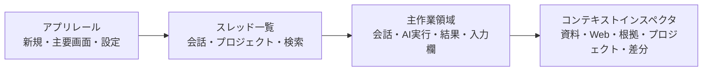

# Onigiri Harness UI再設計仕様

更新日: 2026-10-20  
状態: **Draft 1 — 実装前の合意対象**

## 1. 目的

Onigiri Harnessの機能を減らさず、最初に何をすればよいか、いま何の文脈で作業しているか、次に何を確認すればよいかを一貫して分かるようにする。

通常の利用は会話だけで完結する。資料、Webリサーチ、プロジェクト、AIタスク、根拠・評価は、会話またはプロジェクトに関連付いた必要な時だけ開く。

参考にするのは、[T3 Code](https://t3.codes/) とその [公開リポジトリ](https://github.com/pingdotgg/t3code) から読み取れる、スレッドごとに作業を完結させ、実行・変更・レビューを同じ文脈で扱う操作モデルである。Onigiri HarnessはT3 CodeのUI、ブランド、実装を複製しない。ローカルRAG、根拠記録、Webリサーチ、Vibe Buildを統合するための独自のmacOS UIとして実装する。

## 2. 設計原則

1. **スレッドが作業の単位**  
   会話、Web調査、資料利用、AIタスク、差分確認、回答の根拠を、同じスレッドからたどれるようにする。
2. **段階的に見せる**  
   初期画面には会話と次の操作だけを表示する。専門的な設定、評価、診断はインスペクタまたは設定に置く。
3. **文脈を隠さない**  
   どのモデル、Profile、資料、Web情報、プロジェクトが回答や実行に使われたかを、必要な時に一段で確認できるようにする。
4. **プロジェクトへ自然に進める**  
   会話から「プロジェクトにする」を選ぶと、選んだ会話の要約と目的を下書きとして引き継ぐ。一方で、空のプロジェクトを作る独立した入口も残す。
5. **ローカルファーストを保つ**  
   会話、資料、プロジェクト、設定は現在どおりローカルに保存する。外部検索やAI実行には、送信先と利用状況を明示する。
6. **日英を同じ構造にする**  
   表示言語によって画面構造や主要操作が変わらないよう、すべての新しい文言とアクセシビリティラベルをローカライズする。

## 3. 情報設計

### 3.1 主要な入口

| 入口 | 利用目的 | 作成される作業単位 |
| --- | --- | --- |
| 新しい会話 | 質問、相談、文章作成、軽い調査 | スレッド |
| 新しいプロジェクト | 作りたいものを最初から整理して制作 | プロジェクトと最初のスレッド |
| 会話からプロジェクトにする | 会話が制作・継続作業へ発展した時 | 既存スレッドに関連付いたプロジェクト |
| コンテキストを追加 | 資料を読ませる、資料を選ぶ、RAGを使う | スレッドのコンテキスト |
| Webを調べる | 現在の会話のためにWeb情報を集める | スレッドのリサーチ記録 |

「資料を使う」「Webを調べる」「設定」を、通常会話と同じ重さのワークスペースとして常時選ばせない。資料とWebは会話のコンテキスト、設定はアプリ全体の設定として扱う。

### 3.2 画面構成

通常幅では、次の4領域を採用する。右インスペクタは初期状態で閉じてよい。

| 領域 | 常時表示するもの | 必要な時に表示するもの |
| --- | --- | --- |
| アプリレール | Onigiri、作成ボタン、会話、プロジェクト、リサーチ、下部の設定 | コマンドメニュー、通知バッジ |
| スレッド一覧 | 検索、会話またはプロジェクトのフィルタ、最近使った項目 | 固定、下書き、実行中、確認待ちのフィルタ |
| 主作業領域 | スレッド名、会話・実行イベント、固定入力欄 | AIタスクの進捗、引用付き回答、変更・検証の要約 |
| コンテキストインスペクタ | 閉じている状態を基本とする | 資料、Web、根拠、プロジェクト、AI実行、差分、検証結果 |

狭い幅では、アプリレールとスレッド一覧を一時的なサイドバーにし、インスペクタを右から重ねて開く。内容が縮小して読めなくなることは避ける。

## 4. 会話と入力欄

### 4.1 スレッドヘッダー

主作業領域の上部には、スレッド名と次の状態だけをコンパクトに表示する。

- プロジェクト名。未所属なら表示しない。
- 実行中、確認待ち、失敗などの作業状態。
- `コンテキスト なし` または `コンテキスト 3`。
- Web情報がそのスレッドにある場合だけ `Web 2`。
- インスペクタを開くボタン。

常に `RAG常時` を表示しない。実際に資料を使った回答には、回答の直下に `資料を使用 · 3件` と表示し、クリックで利用チャンクと引用を開く。資料が登録されていない時は「資料あり」と示唆しない。

### 4.2 Composer

入力欄の近くに、現在の会話に関係する選択だけを置く。

| 操作 | 挙動 |
| --- | --- |
| モデル／Profile | コンパクトなポップオーバーで変更。高度なProfile編集は設定へ移す。 |
| コンテキスト | 資料の追加、選択、RAGモード、検索設定をドロワーで開く。 |
| Web | 検索・閲覧・選択済みソースをドロワーで扱う。外部送信の設定は明示する。 |
| プロジェクトにする | 現在の会話からプロジェクト下書きを作成する。 |
| AIに作業を頼む | 現在の会話またはプロジェクトを基に、AIタスクの提案を作成する。 |

送信は現在の日本語IMEの確定操作を壊さない。`Return` はIMEの確定を優先し、確定後に送信する。改行は `Shift + Return` とし、設定で変更可能にする。送信中は停止ボタンを同じ位置に置く。

## 5. RAGと根拠のUI

RAGは独立した常設画面ではなく、スレッドのコンテキストと回答の根拠として扱う。ただし資料の品質を改善するための高度な操作は失わない。

### 5.1 コンテキストドロワー

コンテキストボタンで右インスペクタに次の項目を表示する。

1. **このスレッドで使う資料** — 資料の追加、フォルダ追加、選択解除、対象数。
2. **検索方法** — 無効、常時、必要時の選択。通常は説明文を省き、詳細を展開して表示する。
3. **今回使った資料** — 回答ごとの利用チャンク、関連度、引用、検索語。
4. **資料ライブラリ** — 全資料、チャンクプレビュー、埋め込み状態、再取り込み。
5. **品質・評価** — 検索設定、評価ケース、回帰、選択履歴。これは「詳細」から開く。

資料が0件なら、ドロワー内では「資料はまだありません」と表示し、`資料を追加` と `フォルダを追加` を主操作として置く。チャット画面の恒久的なRAG表示はしない。

### 5.2 根拠の表示

回答カードは、利用時だけ以下を表示する。

- 引用番号と対応する資料名。
- `根拠を表示` で開く、利用チャンク・検索語・検索モード・Profile・モデル・遅延のレシート。
- Evidence Flight Recorderへのリンク。

根拠や資料が使われていない回答は、その事実を簡潔に表示し、以前に削除した資料が回答に影響しているように見える状態を防ぐ。

## 6. Webリサーチ

Webリサーチは会話の補助操作として開始する。検索結果、開いたページ、選んだ引用、要約はスレッドに保存する。

- 検索は `Web` ドロワーまたは会話からの明示的な依頼で始める。
- 選択したソースのみを回答のコンテキストに渡す。
- Tavily、SearXNG、内蔵ブラウザなどのプロバイダ設定は設定画面に置く。
- ホーム、ブックマーク、履歴、別ウインドウは、リサーチの詳細画面で維持する。
- 回答には検索時刻とソースを表示し、ローカル資料と混同しない。

アプリレールの「リサーチ」は、過去のリサーチ記録とブラウザを開くための入口として残す。通常は、会話から開くWebドロワーを主導線とする。

## 7. プロジェクトとAI実行

### 7.1 プロジェクトホーム

プロジェクトを開くと、最初に「今どこまで進んだか」と「次にすること」を表示する。計画、制作、確認、履歴、設定を最初から横並びにしない。

プロジェクトホームには次を置く。

- 目的と完成条件。
- 直近の会話と未解決の問い。
- 次の作業を1つ。
- AIタスク、確認待ち、ブロッカーの要約。
- 進行中のAI実行へ戻る操作。

詳細な計画、隔離ビルド、差分、テスト、統合確認、リリース履歴は、右インスペクタまたは「詳細を見る」から段階的に開く。

### 7.2 AIタスクとレビュー

AIタスクは別の管理画面に閉じ込めず、依頼元のスレッドまたはプロジェクトに実行カードとして表示する。

- 開始前: 実行AI、対象、隔離方法、確認方法を一枚に要約する。
- 実行中: 状態、ログの要約、停止、次の確認時刻を表示する。
- 完了後: 変更概要、検証結果、差分、適用・取り消しを右インスペクタで確認する。
- 並列レーンと競合検出は、プロジェクトの詳細にまとめる。

これはT3 Codeの「エージェントごとの作業と変更確認を同じスレッドで扱う」考え方を、Onigiri Harnessの安全な隔離ビルド・明示適用に対応させるものである。

## 8. グローバル操作とキーボード

| 操作 | 推奨ショートカット |
| --- | --- |
| 新しい会話 | `⌘N` |
| 新しいプロジェクト | `⇧⌘N` |
| コマンドメニュー | `⌘K` |
| 左サイドバーを表示／非表示 | `⌘B` |
| コンテキストインスペクタを表示／非表示 | `⌥⌘I` |
| 会話一覧 | `⌘1` |
| プロジェクト一覧 | `⌘2` |
| リサーチ一覧 | `⌘3` |

`⌘K` では、会話・プロジェクト・資料・Webリサーチ・設定・AIタスクを検索し、作成と移動を行えるようにする。

## 9. 既存データと設定の移行

再設計は見た目と導線を置き換えるものであり、既存のデータを破棄しない。

| 既存データ | 新しい表示先 |
| --- | --- |
| 会話履歴 | スレッド一覧と主作業領域 |
| プロジェクトと明示メモリー | プロジェクト一覧、プロジェクトホーム、インスペクタ |
| 資料・チャンク・検索設定 | コンテキストドロワー、資料ライブラリ、詳細設定 |
| Webリサーチのソース・ブックマーク・履歴 | Webドロワー、リサーチ一覧、詳細ブラウザ |
| AIタスク・隔離ビルド・レビュー | スレッドの実行カード、プロジェクトの詳細 |
| Evidence・回帰結果 | 回答の根拠、品質・評価の詳細画面 |

既存の保存キーとServer APIを維持したまま表示層を段階的に置き換える。各Sub-phaseで、移行前後に会話、資料、プロジェクト、設定が読めることを確認する。

## 10. 実装順序と受入条件

| Sub-phase | 完了条件 |
| --- | --- |
| 7.2 — Adaptive Workspace Shell | アプリレール、スレッド一覧、主作業領域、開閉できるインスペクタが機能し、既存会話を開ける。 |
| 7.3 — Unified Thread & Composer | 会話からコンテキスト、Web、プロジェクト化、AIタスク開始へ移動でき、通常会話は余分なパネルなしで行える。 |
| 7.4 — Context Drawer & RAG Experience | 資料0件ではRAG利用を示唆せず、資料追加から利用チャンク・引用・詳細設定までたどれる。 |
| 7.5 — Project & Agent Run Inspector | プロジェクトの次の作業、AI実行、変更・確認・適用をスレッドとインスペクタで追える。 |
| 7.6 — Visual Acceptance & Data Migration | 日英UI、通常幅・狭い幅、会話・RAG・Web・プロジェクト・AI実行の代表手順で受入確認を完了する。 |

## 11. 実装前に確認する判断

以下を推奨案として採用する。

1. **リサーチは会話内を主導線にする。** アプリレールのリサーチは、保存済み調査と詳細ブラウザへ入る補助入口にする。
2. **RAGはコンテキストと根拠に統合する。** 資料の管理・評価機能は維持し、日常の会話画面からは必要な時だけ開く。
3. **プロジェクトは会話から昇格でき、独立作成もできる。** どちらも同じプロジェクトホームに着地する。
4. **右インスペクタは初期状態で閉じる。** 画面を広く保ち、資料、Web、根拠、プロジェクト、実行結果を同じ場所で確認する。

この4点を前提に、次は **Parent Phase 7 / Sub-phase 7.2 — Adaptive Workspace Shell** を実装する。
